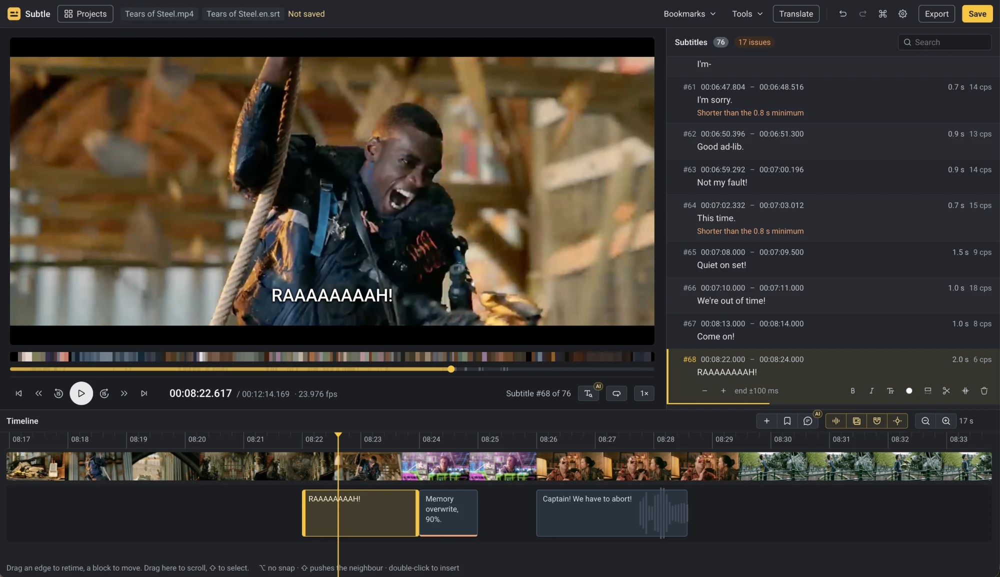
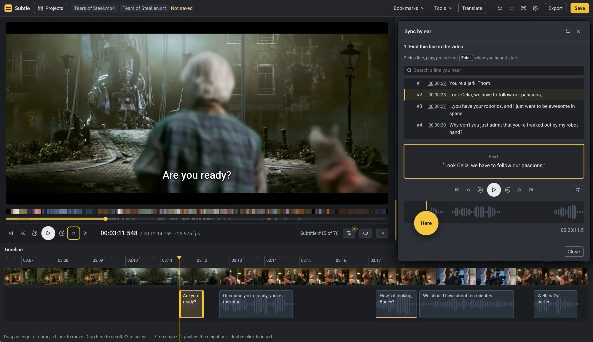
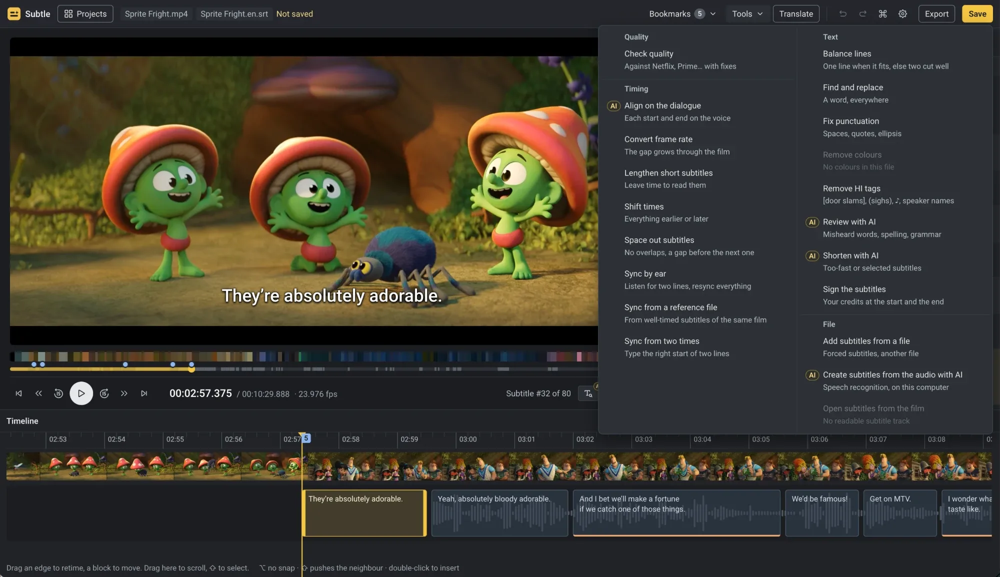
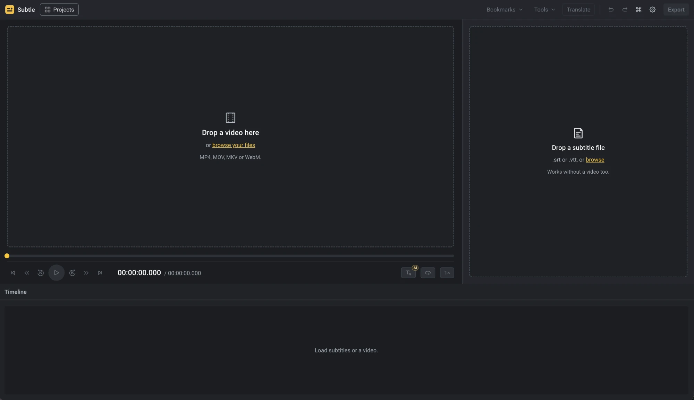

# Subtle

**Subtitles, done right.**

A subtitle editor that runs entirely in your browser. Edit, retime, sync, clean, check, create and translate subtitles while watching the film. Nothing is uploaded: your video and your subtitles never leave your computer.

**AI built in, on your terms**: bring your own AI (Claude, ChatGPT, DeepSeek, Mistral, Gemini with your key, or a local model through Ollama or LM Studio), or use only the models that run on your computer.



## AI, your way

- **Your own AI**: Claude, ChatGPT, DeepSeek, Mistral or Gemini with your API key, any model they offer. Your key stays in your browser and is sent only to that service. You pay the service directly, for what you use: each run shows the tokens it will send before it starts.
- **Or fully local**: a model on your computer through Ollama or LM Studio (or any server speaking the OpenAI API). Nothing leaves your machine.
- **Or no AI service at all**: Chrome's built-in translator, and the models Subtle runs in the browser itself.

What the AI does:

- **Translate** whole films, with scene notes to give it context (who speaks, the tone), and retranslate a selection with your own instruction.
- **Review**: misheard words, spelling, grammar, names; **check a translation** against its original (meaning, what's left out, consistency). Every proposal is shown with the change marked, to accept one by one.
- **Shorten** subtitles too fast to read.

On your computer, no key needed:

- **Subtitles from the audio** (Whisper), **text in the picture** (OCR), **dialogue detection** that draws the speech on the timeline and lets you **align the subtitles on the voices**.

## What it does

- **Files**: subtitles in SRT, VTT, SBV, ASS / SSA, TTML / IMSC (also inside a `.zip`); films in MP4, M4V, MOV, MKV and WebM, including the subtitle tracks inside an MKV. Charset detection (UTF-8, UTF-16, Windows-1252), tags and VTT settings kept.
- **See and hear**: a timeline with the dialogue waveform (speech detection), a filmstrip with exact frames, the subtitle over the video.
- **Edit**: drag blocks and edges on the timeline (with snapping), edit text in the list, italics, bold and colours, top / bottom, insert, split, merge, spotting while playing, undo for everything.
- **Sync**: shift times, sync from two times, sync by ear (a guided assistant), align on the dialogue, sync from a reference file (another language or release), frame rate conversion.
- **Clean and check**: quality report against Netflix, Prime Video or TED rules with fixes, lengthen short subtitles, remove hearing-impaired tags, fix punctuation (French rules included), find and replace.
- **Create**: subtitles from the audio with Whisper, text found in the picture (OCR), both on your computer.
- **Translate**: with Chrome's built-in translator, a local model (Ollama, LM Studio) or an AI service with your own key (Claude, ChatGPT, DeepSeek, Mistral, Gemini), or start from an existing translation file; review and shorten with AI.
- **Work**: projects kept in the browser, save into the subtitle file (Chrome / Edge), export to any format, bookmarks, scene notes, your signature at the start and in the end credits, keyboard shortcuts for everything (press `?`), installable as an offline app, English and French.

| Sync by ear                                       | The Tools menu                                 | Start                                            |
| ------------------------------------------------- | ---------------------------------------------- | ------------------------------------------------ |
|  |  |  |

Screenshots: [_Sprite Fright_](https://studio.blender.org/films/sprite-fright/) (CC BY) © Blender Foundation, studio.blender.org.

## Privacy

- Films and subtitles are read and processed in the browser. Projects, settings and analyses are stored in the browser (localStorage, IndexedDB, Cache Storage).
- Models are downloaded once, from fixed versions, and kept by the browser: speech detection (Silero VAD) and OCR (PaddleOCR) from Hugging Face, speech recognition (Whisper) from Hugging Face, its WebGPU runtime from jsDelivr.
- AI features are optional. With an AI service, the subtitle text is sent to that service with **your own API key**, which is stored in your browser only and sent to nobody else. A local model or Chrome's translator keeps everything on your computer.

## Browsers

Made for Chrome and Edge (desktop). Firefox and Safari open subtitles and play films, but miss some features (the app says which). A large screen and a keyboard are expected.

## Run it

```bash
npm install
npm run dev          # http://localhost:3000
npm run build        # production build in dist/ (a static site: serve it anywhere; BASE_PATH=/subtle/ for a sub-path)
npm run preview      # serve dist/ (the offline app only works from a production build)
```

| Script           |                                         |
| ---------------- | --------------------------------------- |
| `npm test`       | unit tests (Vitest) of the core library |
| `npm run lint`   | Oxlint                                  |
| `npm run format` | Prettier                                |
| `npm run check`  | types, lint, format and tests together  |

Requires Node 22 or later.

## Code

```
src/
  lib/          pure TypeScript, no UI: formats, tools, sync, audio maths… tested in lib.test.ts
  store/        state (Zustand): document, undo / redo, settings, projects, background jobs
  components/   React UI
  media/        reading films (Mediabunny, WebCodecs), speech detection
  workers/      waveform, filmstrip, frames, speech recognition, OCR, MKV subtitles
  mt/           translation engines
  i18n/         every string, English and French
  styles/       CSS, design tokens (see DESIGN.md)
```

`CLAUDE.md` maps where everything is and the rules the code follows (useful with an AI assistant, or without).

## Contributing

See [CONTRIBUTING.md](CONTRIBUTING.md).

## Licence

[MIT](LICENSE)
